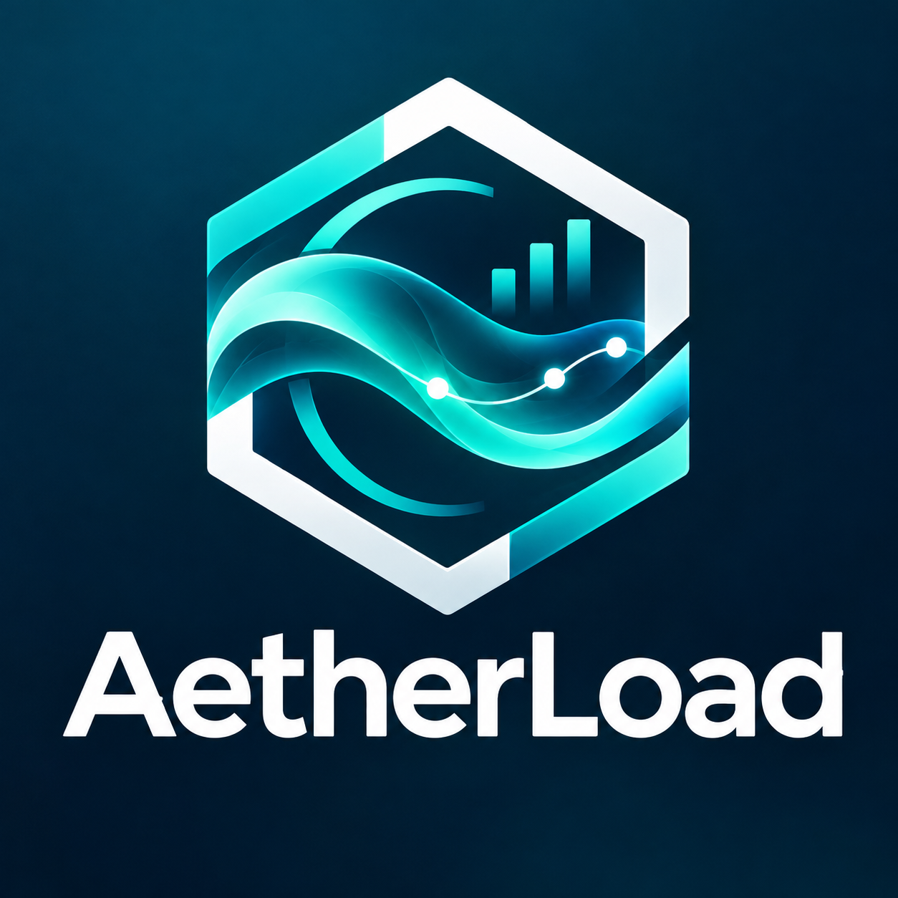

# AetherLoad — Terminal de carga de gas



Identidad visual, componentes y reglas de accesibilidad: [guía de estilos](docs/styling.txt). Implementación y verificaciones: [estilos de AetherLoad](docs/estilos-aetherload.md).

Interfaz web interactiva orientada a la visualización y control operativo del circuito de carga de gas líquido en planta. Diseñada con Next.js (App Router), componentes modulares y gestión de estado para garantizar sincronización en tiempo real.

### Funcionalidades clave:
* **Tablero de control y monitoreo:** Listado dinámico de órdenes con soporte de filtros por estado operativo, detalles de camión, chofer y variables en vivo (masa acumulada, caudal, densidad y temperatura).
* **Cálculo de ETA en tiempo real:** Estimación automática del tiempo restante de llenado según el preset fijado, la masa acumulada y la tasa de caudal.
* **Gestión de alarmas térmicas:** Notificación visual ante desvíos de temperatura configurados en planta y panel de aceptación/reconocimiento para operadores autorizados.
* **Módulo de conciliación:** Consulta y renderizado analítico del balance final de carga para órdenes en estado completado.
* **Seguridad y experiencia de usuario:** Rutas protegidas mediante autenticación y roles, diseño responsivo y feedback interactivo ante estados de carga (*loading*, *empty states* y manejo de errores).

---

## Stack Tecnológico

- **Framework:** [Next.js](https://nextjs.org/) (App Router) + [React](https://react.dev/)
- **Lenguaje:** [TypeScript](https://www.typescriptlang.org/)
- **Estilos:** [Tailwind CSS](https://tailwindcss.com/)
- **Iconos y Utilidades:** [Lucide Icons](https://lucide.dev/) + helper `cn` en `src/lib/utils.ts`

---

## Primeros Pasos

Copiá `.env.example` a `.env.local` y ajustá la dirección del backend (no tiene valor por defecto; sin ella el cliente HTTP falla con un mensaje claro):

```bash
cp .env.example .env.local   # NEXT_PUBLIC_API_URL=http://localhost:8080/api/v1
```

`NEXT_PUBLIC_API_URL` se **incrusta al compilar**: en producción se pasa como `--build-arg` al `docker build` (ver el `Dockerfile` y el workflow). El backend se levanta desde su repo (`iw3-gas-terminal-backend`) y el contrato de la API está en `docs/contrato-api.md`.

Para iniciar el servidor de desarrollo:

```bash
npm run dev
```

Abre [http://localhost:3000](http://localhost:3000) en tu navegador para interactuar con la aplicación.

### Scripts Disponibles

* `npm run dev`: Inicia el servidor local de desarrollo.
* `npm run build`: Compila y genera el bundle optimizado para producción.
* `npm run start`: Ejecuta el servidor en modo producción.
* `npm run lint`: Ejecuta el linter ESLint para análisis de código.
* `npm test`: Ejecuta las pruebas unitarias (todos los `*.test.mjs`) con el ejecutor de Node.
